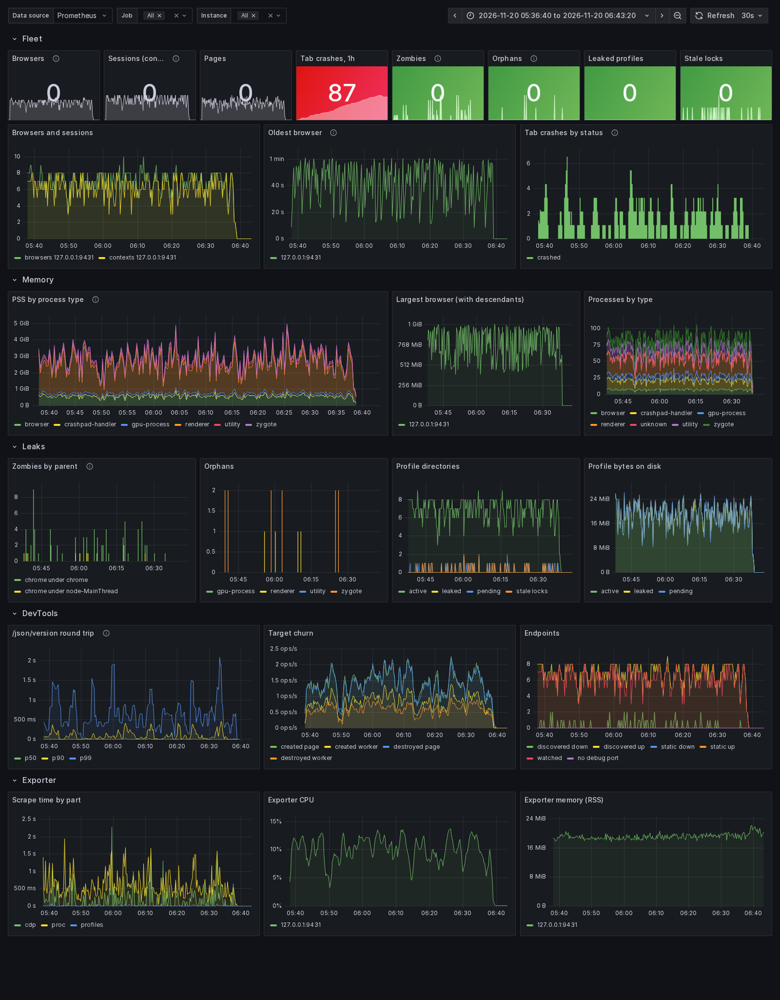

# cdp-exporter

Prometheus metrics for fleets of headless Chrome: what each browser costs, what it leaks, and whether it still answers.

A browser container that looks healthy to the orchestrator can be failing in ways only the browser shows. Tabs crash, renderers keep growing, a browser killed by the OOM killer leaves zombie processes, a temporary profile and a `SingletonLock` behind. cAdvisor sees one RSS number for the whole container, and the browser pools people self-host do not export metrics for any of this ([browserless#3892](https://github.com/browserless/browserless/issues/3892), [browserless#1698](https://github.com/browserless/browserless/issues/1698), [steel-browser#367](https://github.com/steel-dev/steel-browser/issues/367)). The underlying problems are long-standing: [puppeteer#1825](https://github.com/puppeteer/puppeteer/issues/1825) (zombies), [puppeteer#5893](https://github.com/puppeteer/puppeteer/issues/5893) (memory), [browserless#5343](https://github.com/browserless/browserless/pull/5343) (leaked profiles), [browserless#5689](https://github.com/browserless/browserless/pull/5689) (stale `SingletonLock` after an OOM).

cdp-exporter runs next to the browsers, as a sidecar or in the same container, and reads two sources:

- **`/proc`**, for every Chrome process whatever started it (Puppeteer, Playwright, browserless, chromedp, a plain `chrome --headless`). Processes are grouped by `--type` and by the browser they descend from. This part needs no CDP port, so it also covers Playwright browsers on `--remote-debugging-pipe`.
- **The DevTools protocol**, on ports given with `--cdp-endpoint` and on ports it discovers from each browser's `--remote-debugging-port` flag or `DevToolsActivePort` file (Puppeteer's `--remote-debugging-port=0`). One websocket per browser listens to `Target` events. It never attaches to a page or changes browser state.



## What it catches

`test/e2e/run.sh` runs each fault against real Chrome in Docker and waits for the metric. These times come from one run on a 12-core Linux host, with metrics read every 0.5 s:

| Fault | Signal | Seen after |
|---|---|---|
| 5 clients open isolated sessions | `chrome_browser_contexts` = 5 | 0.4 s |
| A renderer crashes (`chrome://crash`) | `chrome_target_crashes_total{status="crashed"}` +1 | 0.6 s |
| A browser is SIGKILLed (OOM killer, `docker kill`, a crashed driver) | `chrome_browsers` drops | 0.5 s |
| ... its profile is left on disk | `chrome_profile_dirs{state="leaked"}` = 1 (6.8 MB) | 2.4 s |
| ... its `SingletonLock` names a dead PID | `chrome_profile_locks{state="stale"}` = 1 | 0.5 s |
| ... and Node is PID 1 with no init | `chrome_defunct_processes{comm="chrome",parent="node"}` = 7, plus 2 `chrome_crashpad` | 0.5 s |

With `docker run --init`, the same kill leaves no zombies, but the leaked profile and the stale lock are still there. An init process reaps zombies; it does not clean up after Chrome.

## browserless under load

`test/soak/run.sh` runs [browserless](https://github.com/browserless/browserless) (`ghcr.io/browserless/chromium:v2.63.1`, `CONCURRENT=8`, `TIMEOUT=60000`) in a container with a memory limit, cdp-exporter beside it, and Prometheus scraping every 5 s. Ten clients keep sessions going over raw CDP: most open a few heavy tabs and disconnect, some are SIGKILLed mid-session, some hold the browser past the timeout, some crash a tab with `chrome://crash`, some load a page that keeps allocating, and 5% load a runaway page that allocates 200 MB/s until something is killed.

**Without the runaway page, one hour at a 6 GiB limit** (`WITHOUT=hog`): 1,841 sessions, 290 of them from clients SIGKILLed mid-session, and none failed. Nothing leaked.

| | |
|---|---|
| Chrome PSS, average over minutes 3 to 13 and 50 to 60 | 2,853 MiB, 2,985 MiB |
| Container memory before and 150 s after the load | 709 MiB, 735 MiB |
| Oldest browser (session timeout 60 s) | 61.6 s |
| Browsers at once (`CONCURRENT=8`) | up to 10, briefly |
| Zombies, orphans, stale locks | up to 9, 2 and 2 at a time; none lasted long enough to fire an alert, none left after the run |
| Leaked profile directories | 0 during the run, and no directory left after it |
| Alerts that fired | `ChromeTabCrashes` only, from the `chrome://crash` sessions |
| Exporter | 18 to 23 MiB RSS, no growth; 9.4% of one core on average with 5 s scrapes and a new browser every 2 s |

The exporter counted 92 tab crashes for 175 `chrome://crash` sessions. Run one at a time against the same browserless, it counted 20 of 20. Most likely, under load it attaches to a new browser later (it looks for new browsers every 2 s, and `/json/version` took up to 0.7 s at p99), so a crash in the first seconds of a short session can be missed.

**With the runaway page, browserless does not survive.** At a 3 GiB limit it went down after 3.5 minutes; at 6 GiB, after 12 minutes. In the 6 GiB run:

- One browser grew to 3.6 GiB (`chrome_browser_memory_max_bytes`) inside the 60 s session timeout. Chrome's PSS reached 5,989 MiB of the 6 GiB limit.
- The kernel's cgroup OOM killer killed 16 processes, all of them renderers (`oom_score_adj` 300). It never picked Node.
- Then browserless's Node process exited with SIGABRT (exit code 134) and logged no reason. Every open session dropped; the container was gone.
- Before that, a browser lived 185 s against the 60 s timeout, and 9 browsers ran with `CONCURRENT=8`.

A session timeout does not bound memory: a page that allocates 200 MB/s exhausts a 6 GiB pod well within 60 s, and one such tab takes every other session on the pod down with it. `chrome_browser_memory_max_bytes` and the `killed` crash status show it coming; `--ready-max-memory-bytes` can stop new sessions from landing on that pod, but nothing in the pool stops the tab.

## Metrics

| Metric | Labels | Meaning |
|---|---|---|
| `chrome_browsers` | | Running browser processes (one per browser instance or session) |
| `chrome_processes` | `type` | Running Chrome processes by `--type`: browser, renderer, zygote, gpu-process, utility |
| `chrome_process_resident_memory_bytes` | `type` | Sum of RSS. Shared pages count once per process, so this overstates |
| `chrome_process_proportional_memory_bytes` | `type` | Sum of PSS from `smaps_rollup`, for processes where it is readable |
| `chrome_process_pss_unreadable` | | Processes left out of the PSS sum |
| `chrome_browser_memory_max_bytes` | | The largest browser together with its descendants |
| `chrome_browser_oldest_age_seconds` | | Age of the oldest browser. A browser that never goes away is usually a leaked session |
| `chrome_orphan_processes` | `type` | Renderers, zygotes and utilities whose browser is gone |
| `chrome_orphan_resident_memory_bytes` | | RSS held by orphans |
| `chrome_defunct_processes` | `comm`, `parent` | Zombies in the PID namespace and who fails to reap them |
| `chrome_profile_dirs` | `state` | User-data directories: `active`, `leaked`, or `pending` (unused, inside the grace period) |
| `chrome_profile_dir_bytes` | `state` | Their size on disk |
| `chrome_profile_locks` | `state` | `SingletonLock` files: `live`, `stale` (dead PID on this host), `foreign` (another hostname) |
| `chrome_cdp_endpoints` | `source`, `state` | Static and discovered endpoints, up or down. Each browser is counted once even when reachable on two ports |
| `chrome_cdp_up` | `endpoint` | Per static endpoint |
| `chrome_cdp_request_duration_seconds` | | Histogram of `/json/version` round trips. A busy browser answers slowly before it fails |
| `chrome_targets` | `type` | Targets from `/json/list`: page, iframe, service_worker, ... |
| `chrome_browser_contexts` | | Browser contexts that own a target. Playwright and browserless use one per client |
| `chrome_targets_created_total`, `chrome_targets_destroyed_total` | `type` | Target churn |
| `chrome_target_crashes_total` | `type`, `status` | `Target.targetCrashed` events: crashed, killed, oom, ... |
| `chrome_browsers_without_debug_endpoint` | | Browsers only `/proc` can see (pipe mode) |
| `chrome_cdp_watched_endpoints` | | Browsers with an open event websocket |
| `chrome_cdp_watch_reconnects_total` | | Times an event websocket was re-established after it dropped while its browser kept running |
| `chrome_exporter_*` | | Scrape duration per part, errors, build info |

No metric has a PID or session label, so cardinality does not grow with traffic.

## Run it

The exporter must see the browser's PID namespace and, for profile metrics, the same `/tmp`. Run it as the same UID **and GID** as Chrome. The kernel shows `/proc/<pid>/smaps_rollup` (PSS) only to a process with both, and Chrome's `0700` profile subdirectories only to that user. Root in a rootless or unprivileged container is not enough: without `CAP_SYS_PTRACE` it cannot read another user's `smaps_rollup` either. The image runs as 65532:65532 by default. For browserless, which runs Chrome as `blessuser`, use `--user 999:999`; for images that run Chrome as root, `--user 0:0`.

Docker, next to an existing browserless container:

```sh
docker run -d --name cdp-exporter --user 999:999 \
  --pid=container:browserless --network=container:browserless --volumes-from browserless \
  ghcr.io/shanurwan/cdp-exporter:v0.1.0
curl -s localhost:9431/metrics   # from inside the shared network namespace
```

`--volumes-from` shares only declared volumes. browserless keeps its profiles in `/tmp` and does not declare it, so start browserless with `-v /tmp`.

The image is built for linux/amd64 and linux/arm64. Release binaries are on the [releases page](https://github.com/shanurwan/cdp-exporter/releases). From source: `go build ./cmd/cdp-exporter`.

### Kubernetes

[`deploy/kubernetes/browserless.yaml`](deploy/kubernetes/browserless.yaml) runs browserless with cdp-exporter as a sidecar: `shareProcessNamespace: true`, one `emptyDir` for `/tmp` mounted in both containers (read-only in the exporter), the exporter as UID/GID 999 with a read-only root filesystem and no capabilities, and a headless `browserless-metrics` Service for Prometheus. `SingletonLock` holds the pod's hostname, which both containers share, so lock states work without flags.

With a shared process namespace the pause container is PID 1 and reaps zombies, so `chrome_defunct_processes` stays at 0 in this setup even when a browser is killed. Leaked profiles and stale locks are not reaped by anything.

`test/kind/run.sh` deploys this manifest to a kind cluster in CI and checks it: metrics through the API server, PSS readable for every Chrome process, the readiness gate taking a pod out of the Service at 4 browsers (1 s after the fourth session started) and putting it back 2 s after one browser is SIGKILLed, and no zombies after the kill.

## Health and readiness

- `/healthz` answers while the exporter runs.
- `/readyz` fails when a static endpoint does not answer `/json/version`, and, when set, when the pod is full:
  - `--ready-max-browsers=N`: N browsers run;
  - `--ready-max-browser-memory-bytes=B`: the largest browser with its descendants uses more than B;
  - `--ready-max-memory-bytes=B`: all Chrome processes together use more than B.

Used as the readiness probe of a sidecar, this makes the Service stop sending new sessions to that pod. Sessions it already holds keep their connections. The memory limits read PSS on every probe; see the cost below.

## Alerts and dashboard

- [`deploy/prometheus/alerts.yml`](deploy/prometheus/alerts.yml): zombies, orphans, leaked profiles, stale locks, tab crashes, browsers that never exit, a CDP endpoint down or slow, and a failing proc scan. Each alert says what usually causes it. [`alerts_test.yml`](deploy/prometheus/alerts_test.yml) runs them with `promtool test rules` in CI.
- [`deploy/grafana/cdp-exporter.json`](deploy/grafana/cdp-exporter.json): fleet, memory, leaks, DevTools and the exporter's own cost, by job and instance.

## Cost

`test/bench/overhead.sh` starts 30 browsers with 4 tabs each (450 Chrome processes), runs the exporter beside them and scrapes it every 15 s for 5 minutes. On a 12-core Linux host:

| | `--pss=true` (default) | `--pss=false` |
|---|---|---|
| CPU | 4.7% of one core | 3.0% |
| Memory (RSS) | 20 MiB | 20 MiB |
| `/proc` part of a scrape, mean (max) | 365 ms (1,164 ms) | 29 ms (97 ms) |
| DevTools part, mean | 5 ms | 11 ms |
| Profiles part, mean | 27 ms | 33 ms |

Reading PSS dominates: the kernel walks each process's page tables to compute `smaps_rollup`, 1 to 2 ms per Chrome process here. With `--pss=false` the exporter reports RSS only. The background loop that discovers browsers and keeps event websockets open runs every 2 s and never reads PSS.

## Flags

| Flag | Default | |
|---|---|---|
| `--listen` | `:9431` | |
| `--cdp-endpoint` | | Repeatable. A DNS name works: the exporter sends `Host: localhost`, which Chrome requires since its DNS-rebinding check |
| `--cdp-timeout` | `3s` | Timeout of each CDP HTTP call |
| `--discover` | `true` | Find ports from browser flags and `DevToolsActivePort` |
| `--discover-host` | `127.0.0.1` | |
| `--watch` | `true` | Event websocket per browser |
| `--proc-root` | `/proc` | |
| `--process-pattern` | Chrome, Chromium, headless-shell names | Regexp on the executable name or kernel `comm` |
| `--pss` | `true` | Read `smaps_rollup`. Needs the same UID and GID as Chrome, or `CAP_SYS_PTRACE` |
| `--profile-glob` | Puppeteer, Playwright and browserless temp dirs | Repeatable |
| `--profile-grace` | `2m` | Age before an unused profile counts as leaked |
| `--profile-size-ttl` | `30s` | How long a profile directory size is cached |
| `--lock-hostname` | this host | Hostname Chrome writes into `SingletonLock` |
| `--no-profiles` | `false` | |
| `--ready-max-browsers`, `--ready-max-browser-memory-bytes`, `--ready-max-memory-bytes` | `0` (off) | See readiness |
| `--log-level` | `info` | |

## Limits

- RSS sums double-count shared memory. Use the PSS metrics where they are readable.
- When a proxy resolves the target, nothing here sees it: the exporter measures the browser, not the sites it visits.
- A browser on `--remote-debugging-pipe` (Playwright's default) has no port to watch, so its crashes and contexts are not counted; `/proc` metrics still cover it.
- Browser processes in another PID namespace are invisible. Run one exporter per pod or container.
- The exporter observes; it does not kill a runaway tab or clean up a leaked profile.

## Tests

```sh
go test -race ./...                                  # unit tests: fake /proc, profiles, a fake DevTools server
promtool test rules deploy/prometheus/alerts_test.yml
./test/e2e/run.sh        # real Chrome in Docker; prints a PASS/FAIL line per check
./test/kind/run.sh       # the Kubernetes manifest on kind (needs kind and kubectl)
./test/soak/run.sh       # browserless under load for an hour, with Prometheus
./test/bench/overhead.sh # the exporter's CPU and memory with 30 browsers
```

CI runs the first four on every push.

## License

Apache-2.0
